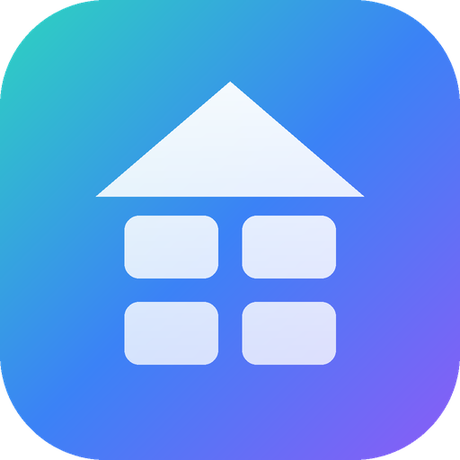

# GlassHouse

A fast, good-looking photo viewer for Windows. It opens 90+ picture formats (JPG, PNG, WEBP, GIF, SVG, AVIF, JXL, HEIC, RAW and more), with a gallery strip, slideshows, cropping, colour picking, printing and themes.

GlassHouse is a personal copy of [ImageGlass](https://github.com/d2phap/ImageGlass) 10.1 by Dương Diệu Pháp, kept and fixed by its owner. It looks and works like ImageGlass, with these differences:

- **Everything is on.** The features ImageGlass sells as "Pro" are switched on: live folder updates, auto-opening new pictures, custom mouse buttons, free panning, HDR tone mapping and the full projector (second screen) tools.
- **It's portable.** Everything lives in one folder, settings included. Copy the folder to another PC or a USB stick and it carries on where you left off. No install, nothing else needed.
- **It keeps to itself.** No update checks, usage stats or licence prompts. "Check for update" just opens the GlassHouse releases page.
- **It runs next to ImageGlass.** It has its own name, settings and file associations, so both can be installed at once.

## Download and use

1. Go to [Releases](https://github.com/DontGoToCollege/GlassHouse/releases) and download the newest `GlassHouse-<version>.zip`.
2. Unzip it anywhere you can write to (Desktop, Documents, a USB stick; not Program Files).
3. Open `GlassHouse\GlassHouse.exe`. To open pictures with it by default, use **Settings > File type associations**.

Windows 10 or 11, 64-bit.

## Building it yourself

Run `.\build.ps1` in PowerShell. The first time, it fetches the .NET 11 SDK into the project folder. It also needs Microsoft's C++ Build Tools, which `Get-ClaudeRules.cmd` installs.

- `.\build.ps1 -Test` makes a trial build in `.test\GlassHouse` and archives nothing.
- `.\build.ps1` builds the version set in `source\Directory.Build.props` (`GhVersion`), checks that it starts, keeps a zip in `Versions\Archive`, and updates the `GlassHouse` folder in place without touching your settings.

The code is ImageGlass's: `source\ImageGlass.Win32` is the Windows app and `source\ImageGlass.Lib` holds everything else. Fixes from ImageGlass can be pulled in from the `upstream` remote.

## Credits

GlassHouse is built on [ImageGlass](https://imageglass.org) by Dương Diệu Pháp and its contributors. ImageGlass is a trademark of Dương Diệu Pháp. If you like this viewer, consider [supporting ImageGlass](https://imageglass.org/donate).

## License

GPLv3: free for anyone to use, change and share, as long as changed copies stay open source under the same licence. See [LICENSE](LICENSE).
